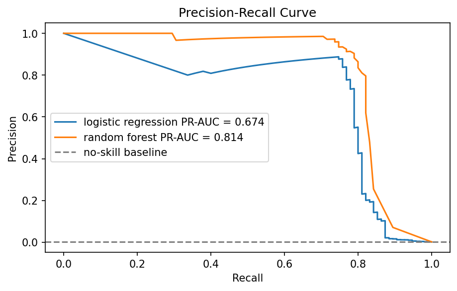
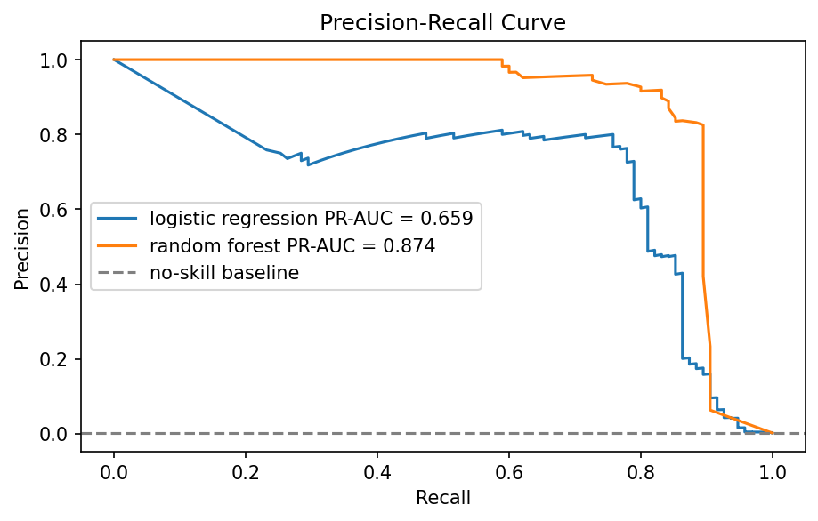
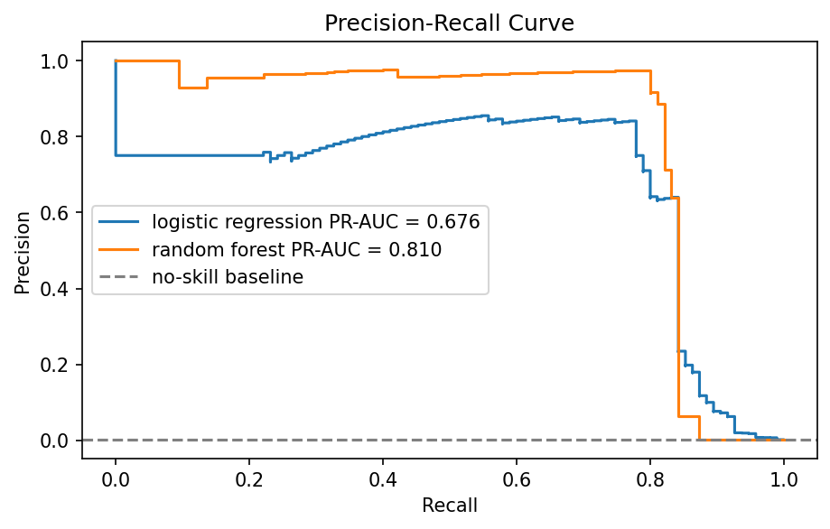

# Credit Card Fraud Detection Pipeline

End-to-end machine learning pipeline on a highly imbalanced dataset (0.17% fraud):
data validation and cleaning, feature engineering, Logistic Regression vs Random Forest,
leakage-safe preprocessing, threshold tuning, pytest tests, Docker and Jenkins CI.

## Dataset
[Credit Card Fraud Detection (ULB, Kaggle)](https://www.kaggle.com/datasets/mlg-ulb/creditcardfraud):
284,807 transactions over two days, 492 frauds. `V1`–`V28` are PCA-anonymised;
`Time` and `Amount` are raw. The 150 MB CSV is not in the repo: download
`creditcard.csv` into `data/raw/`.

## What the pipeline does
1. **Validate and clean** – schema, missing values; 1,081 duplicate rows
   removed (283,726 rows, 473 frauds remain).
2. **Features** – `log1p(Amount)` and an approximate hour of day; numeric columns scaled
   inside a scikit-learn `Pipeline`, so the scaler only learns from training data.
3. **Models** – Logistic Regression and Random Forest with class weights, stratified
   80/20 split.
4. **Evaluation** – precision, recall, F1 and PR-AUC (accuracy and ROC-AUC are misleading
   at 0.17% fraud). Decision thresholds are tuned on out-of-fold predictions from the
   training set only; the test set is used once.

## Results
Test set, default threshold 0.5 (mean ± std):

| Model | PR-AUC | Precision | Recall |
|-------|--------|-----------|--------|
| Logistic Regression | 0.674001 | 0.054894 | 0.873684 |
| Random Forest | 0.813722 | 0.985294 | 0.705263 |

## Findings
- Random Forest ranks fraud better than Logistic Regression on every split I tried
  (PR-AUC 0.81–0.87 vs 0.66–0.69 over seeds 42, 58, 60).
- At the default threshold, Logistic Regression flags about 1,400 normal transactions
  to catch ~85 frauds; tuning its threshold removes almost all of those false alarms.
- For Random Forest, lowering the threshold to about 0.2–0.4 catches a few more frauds
  at little cost; F1 is flat across that range.
- Dropping the raw `Time` column made no measurable difference (PR-AUC change under 0.01).

## Limitations
- The test set holds about 95 frauds, so differences of a few frauds are within noise.
- F1 weights precision and recall equally; a real deployment would set the threshold
  from the cost of a missed fraud versus a false alert.
- The features are anonymised, so results can't be interpreted in business terms.

## Project structure
`src/` (clean, features, evaluate, train) · `test/` (pytest) · `notebooks/` (EDA, time column experiment,threshold
analysis) · `reports/` · `Dockerfile` · `Jenkinsfile`

## How to run
**Local**
    python -m venv .venv && source .venv/bin/activate   # Windows: .venv\Scripts\activate
    pip install -r requirements.txt
    python -m src.train
    python -m pytest -v

**Docker**
    docker build -t fraud-detection .
    docker run --rm -v "$(pwd)/data:/app/data" fraud-detection
    docker run --rm fraud-detection python -m pytest -v

## Continuous integration (Jenkins)

The `Jenkinsfile` in the repo root defines a declarative pipeline with two stages:

1. **Build image** – builds the Docker image from the `Dockerfile`.
2. **Test** – runs the pytest suite inside the container (`python -m pytest -v`).

Jenkins polls this repository for new commits [(Fridays and Saturdays)] and runs the
pipeline; a build can also be started manually. Training is not part of CI because the
150 MB dataset is not stored in the repo.

Jenkins runs locally on my Ubuntu laptop, so there is no public build badge.

### Reproducing the setup (Ubuntu)
1. Install Java 21 and Jenkins LTS from the official apt repository
   (see the [Jenkins installation guide](https://www.jenkins.io/doc/book/installing/linux/)).
2. Install Docker Engine and add the `jenkins` user to the `docker` group
   (`sudo usermod -aG docker jenkins`, then restart Jenkins).
3. Create a **Pipeline** job, choose *Pipeline script from SCM*, point it at this repository
   and set the script path to `Jenkinsfile`.
